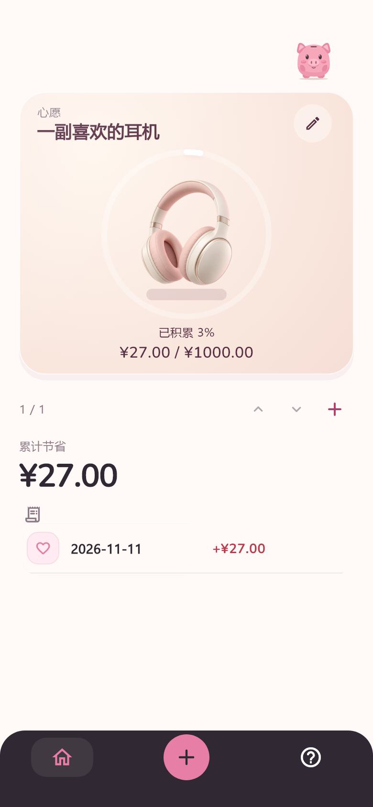
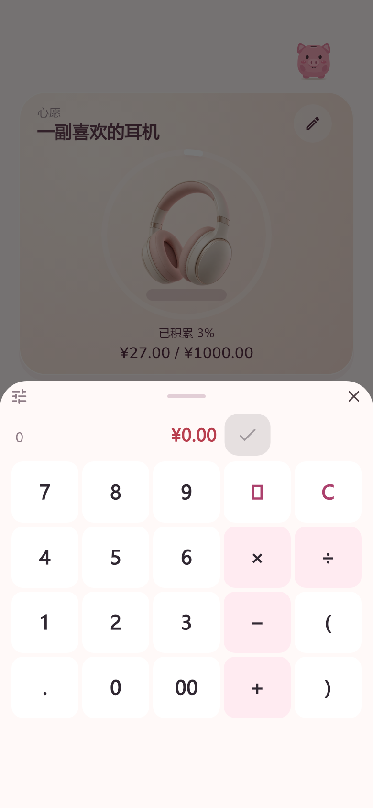

# Wallehog

[English](README.md) · [简体中文](README.zh-CN.md)

An offline Android companion for mindful spending choices. Tap **+ → enter an amount → save**, watch your wishes progress, and share a small moment with your piggy bank.

**Version 1.0 · Android APK.** Choose Simplified Chinese or English in **Help → Language**.

## Features

- Quick amount entry with arithmetic, optional notes and dates; edit, delete and rebind records.
- Multiple wishes with separate progress. Swipe vertically to switch; the first wish adopts unbound records when no wishes exist.
- A **2 × 2 Android home-screen widget** showing the current wish. Tap **+**, enter an amount and save directly in the widget. Create, edit and switch wishes in the app.
- Gentle pig reactions, optional sound and reduced-motion support.
- Local SQLite storage and JSON backup/restore. No accounts, ads, telemetry, banking connections or cloud synchronization.

Saved amounts are self-reported savings, **not deposits, bank balances or spendable funds**. No mandatory budgets, categories or missed-day penalties.

## Preview

Flutter-rendered 390 × 844 phone previews using fictional data. They illustrate the main app; see [widget usage](docs/HOME_WIDGET.md) for the launcher feature.

 

Native Android widget preview with fictional data:


## Download

[Download the recommended ARM64 APK](https://github.com/Naclarb/Wallehog/releases/latest/download/Wallehog-Android-arm64.apk) for ARM64 Android devices. Both packages include the same features and use the same official certificate and version code.

| Package | 1.0 download size | Supported architecture |
| --- | --- | --- |
| [ARM64](https://github.com/Naclarb/Wallehog/releases/latest/download/Wallehog-Android-arm64.apk) | 23.02 MiB | arm64-v8a |
| [Universal](https://github.com/Naclarb/Wallehog/releases/latest/download/Wallehog-Android.apk) | 57.00 MiB | ARM, ARM64, x86_64 |

The pre-alpha's 22.95 MiB package was ARM64-only. The 1.0 universal package carries two additional native architectures; selecting ARM64 reduces the download by 59.6%. Sizes use MiB (1,048,576 bytes). Checksums are available on the [release page](https://github.com/Naclarb/Wallehog/releases/tag/v1.0.0).

Add the **Wallehog** widget using your launcher's widget picker. Launcher cell sizes vary; remove and re-add older widget instances for the 2 × 2 default.

Version 1.0 uses a persistent release certificate. Older development-signed copies may have a different certificate and cannot be updated in place. Export and verify a backup before migrating; keep the backup until your records and settings have been checked. See [signing and migration](docs/ANDROID_RELEASE.md). No iOS, desktop or web build is distributed.

## Build

Validated toolchain: Flutter **3.47.7**, Dart **3.13.5**, JDK **17**, Android SDK/NDK requested by Flutter. Accept Android SDK licenses. Dependency downloads require internet; app operation does not.

```sh
flutter pub get
flutter analyze
flutter test
flutter run
# Configure private release credentials first; see docs/ANDROID_RELEASE.md.
flutter build apk --release --target-platform android-arm64
```

For a universal build, use `--target-platform android-arm,android-arm64,android-x64` instead. Both commands produce `build/app/outputs/flutter-apk/app-release.apk`; the release workflow copies each output before the next build. Gradle wrapper and `pubspec.lock` are committed. SDK paths and signing inputs stay private. Tests use system SQLite (`winsqlite3` on Windows). Builds made with other keys cannot update the official APK.

## Privacy and license

Backups are unencrypted JSON; store them privately. Device coverage is limited, so keep backups. Public source includes runtime assets, tests, build configuration and selected documentation. Local device captures, development archives, experiments, credentials and build outputs are excluded. See [current status and repository audit](docs/STATUS.md).

Source: [MIT](LICENSE). [Asset and dependency credits](docs/public/CREDITS.md). The controller illustration is a wish symbol; no brand affiliation is implied.
