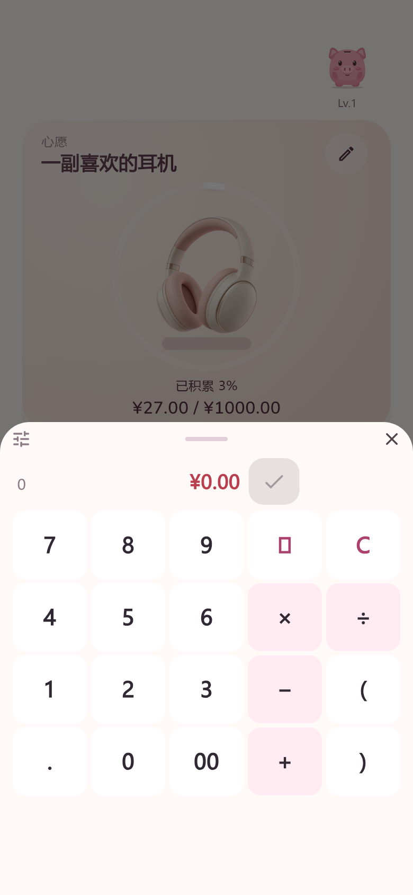

# Wallehog · 电子猪

[English](README.md) · [简体中文](README.zh-CN.md)

一款离线的 Android 积极消费决策记录工具。**加号 → 输入省下的金额 → 确认**，观察心愿进度，获得小猪的轻量回应。

**当前为 Pre-alpha，仅提供 Android arm64-v8a APK。** 功能和外观仍会变化，界面目前以简体中文为主。

金额是你自行报告的节省成果，**不代表真实存款、余额或可花资金**。无需强制预算或分类，不惩罚断签；没有账号、广告、银行连接或遥测。记录存于本机 SQLite，支持修改、删除及备份恢复。

## 手机预览

390 × 844 手机视口的 Flutter 渲染预览，使用虚构演示数据；不是物理手机实拍或真机截图。

 

## 下载与运行

从 [Releases](https://github.com/Naclarb/Wallehog/releases) 下载 APK；不支持 32 位及 x86 Android 设备，也不提供 iOS、桌面或网页版。当前预览 APK 使用开发签名，未来更换签名可能无法覆盖安装。更换安装包前先导出备份，不要在未备份时卸载已有应用。

验证工具链：Flutter **3.47.7** / Dart **3.13.5**、JDK **17**、Android SDK。安装 Flutter 要求的 SDK/NDK 并接受 Android SDK 许可。仓库保留 Gradle wrapper 和 `pubspec.lock`；首次构建下载依赖需要联网，应用运行不需要。

```sh
flutter pub get
flutter analyze
flutter test
flutter run
flutter build apk --release --target-platform android-arm64
```

APK 位于 `build/app/outputs/flutter-apk/app-release.apk`。本机 SDK 路径由工具生成，不提交。测试使用系统 SQLite，Windows 使用 winsqlite3，其他主机需提供系统 SQLite。可复现构建环境不代表跨机器、跨签名的 APK 字节完全相同。

## 限制与许可

仍处早期开发阶段，设备覆盖有限，没有云同步。请自行备份；导出的 JSON 未加密，应私密保存。手柄插图仅为心愿示意，不代表品牌关联。

源码采用仓库已有的 [MIT 许可](LICENSE)。素材及依赖见[来源说明](docs/public/CREDITS.md)。仓库仅纳入运行资源、测试、构建配置与必要公开文档；开发档案、实验废稿和本地数据不上传。

