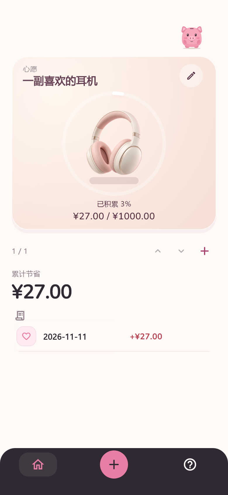
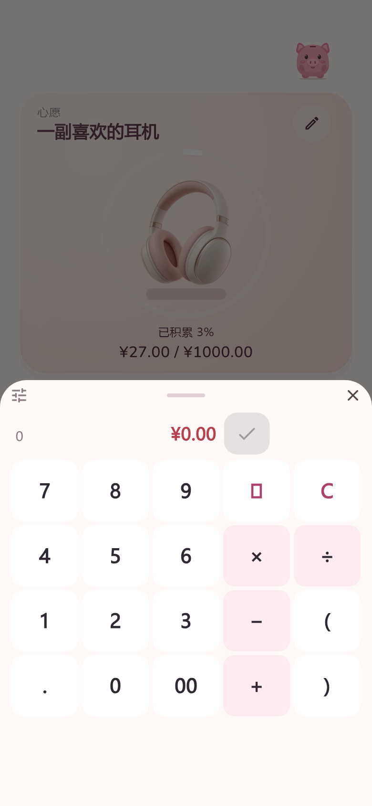

# Wallehog · 电子猪

[English](README.md) · [简体中文](README.zh-CN.md)

一款离线的 Android 积极消费决策记录工具。**加号 → 输入省下的金额 → 保存**，观察心愿进度，获得小猪的轻量回应。

**1.0 正式版 · Android APK。** 在**帮助 → 语言**中选择简体中文或英文。

## 功能

- 快速金额录入，支持四则运算、可选备注和日期，以及记录编辑、删除和改绑。
- 多心愿独立进度，上下滑动切换；没有心愿时创建第一个心愿，会接收未绑定记录。
- **2 × 2 Android 桌面 Widget**，展示当前心愿。直接在 Widget 中点 **+ → 输入金额 → 保存**；心愿创建、编辑和切换在应用内完成。
- 小猪轻量回应、可选音效，以及减少动画支持。
- 本地 SQLite 存储和 JSON 备份恢复；没有账号、广告、遥测、银行连接或云同步。

金额是自行报告的节省成果，**不代表真实存款、余额或可花资金**。无需强制预算或分类，不惩罚断签。

## 预览

390 × 844 手机视口的 Flutter 渲染预览，使用虚构数据。图片展示主应用；桌面功能见 [Widget 使用说明](docs/HOME_WIDGET.zh-CN.md)。

 

使用虚构数据的原生 Android Widget 预览：


## 下载

ARM64 Android 设备推荐[下载 ARM64 小包](https://github.com/Naclarb/Wallehog/releases/latest/download/Wallehog-Android-arm64.apk)。两种包的功能、正式证书和版本号相同。

| 安装包 | 1.0 下载体积 | 支持的架构 |
| --- | --- | --- |
| [ARM64](https://github.com/Naclarb/Wallehog/releases/latest/download/Wallehog-Android-arm64.apk) | 23.02 MiB | arm64-v8a |
| [通用包](https://github.com/Naclarb/Wallehog/releases/latest/download/Wallehog-Android.apk) | 57.00 MiB | ARM、ARM64、x86_64 |

Pre-alpha 的 22.95 MiB 包仅含 ARM64。1.0 通用包多带了两种原生架构；选择 ARM64 后下载体积减少 59.6%。MiB 按 1,048,576 字节计算，校验文件见[发布页](https://github.com/Naclarb/Wallehog/releases/tag/v1.0.0)。

在桌面启动器的组件列表中选择 **Wallehog**。不同启动器的格子尺寸有所不同；旧 Widget 可移除后重新添加，采用默认 2 × 2 布局。

1.0 使用持久发布证书。旧开发签名安装可能使用不同证书，无法直接覆盖升级。迁移前先导出并验证备份，核对记录与设置后再处理备份。详见[签名与迁移](docs/ANDROID_RELEASE.zh-CN.md)。不提供 iOS、桌面或网页版安装包。

## 构建

验证工具链：Flutter **3.47.7**、Dart **3.13.5**、JDK **17**、Flutter 要求的 Android SDK/NDK；需接受 Android SDK 许可。下载依赖需要联网，应用运行不需要。

```sh
flutter pub get
flutter analyze
flutter test
flutter run
# 先配置私有发布凭据，详见 docs/ANDROID_RELEASE.zh-CN.md。
flutter build apk --release --target-platform android-arm64
```

需要通用包时，将目标改为 `--target-platform android-arm,android-arm64,android-x64`。两种命令均输出 `build/app/outputs/flutter-apk/app-release.apk`，发布工作流会先复制产物再进行下一次构建。仓库保留 Gradle wrapper 和 `pubspec.lock`；SDK 路径与签名输入保持私有。测试使用系统 SQLite，Windows 使用 `winsqlite3`。其他签名构建无法覆盖官方 APK。

## 隐私与许可

备份为未加密 JSON，请私密保存。设备覆盖有限，请保留备份。公开源码包含运行资源、测试、构建配置和选定文档；本地设备截图、开发档案、实验、凭据和构建产物不纳入跟踪。参见[当前状态与仓库审计](docs/STATUS.zh-CN.md)。

源码采用 [MIT 许可](LICENSE)，素材和依赖见[来源说明](docs/public/CREDITS.zh-CN.md)。手柄插图仅为心愿示意，不代表品牌关联。
