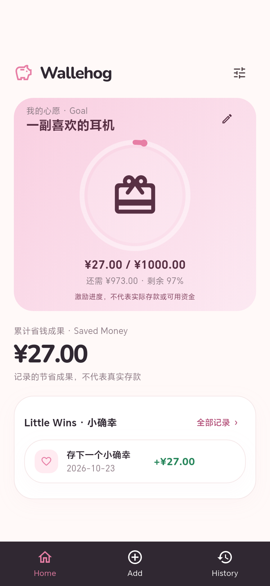
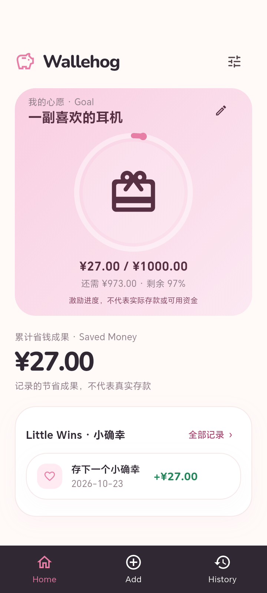

# Locked UI v1.0 实施与验证

日期：2026-10-23。依据用户锁定合同，需求编号 L01–L06；覆盖旧 Phase 2 首页构图。

## 本次实现

- 首页按品牌、粉色 Goal 场景、紧凑累计金额、白色 Little Wins、深色固定底栏排列。
- Goal 约 307dp（空状态约 311dp，长名称/大字体自适应）；圆角 28dp，圆环 165dp。圆环中央使用独立愿望礼物图标；无目标时使用保留的 3D 猪与创建入口。编辑入口完整保留。
- 圆环连接真实 Goal 进度并支持 Flutter 原生过渡；¥27 / ¥1000 的示例实际进度为 2.7%，剩余 ¥973，剩余百分比展示四舍五入 97%。不伪造进度。
- 累计摘要展示全局真实汇总，Goal 只包含目标创建边界之后的记录。两处资金语义说明保留。
- Little Wins 只显示最近三笔正金额记录，点击直接复用计算器编辑；全部记录与 History 打开现有历史页面。
- Scaffold.bottomNavigationBar 的 64dp 导航另加 SafeArea；Home 回首页顶部，Add 直接计算器，History 进入历史。三个图标均为 Flutter Material 线框图标，24dp 对齐。
- 首页移除大型猪；成功反馈 SnackBar 使用 54dp 猪；Goal 空状态使用 96dp 猪。未实现复杂动画。
- 保留 SQLite、控制器、整数金额及表达式解析，未新增依赖、功能或必填字段。

## 实际验证

| 项目 | 结果 |
| --- | --- |
| 格式化 | lib、test、integration_test 共 28 文件，0 改动 |
| flutter analyze | 通过，无问题 |
| flutter test | 98 项全部通过，含领域、SQLite、迁移、幂等写入、目标边界与 widget |
| 390×844、360×800 widget | 上下各 24dp 模拟安全区域；Goal/累计/Little Wins/Add 首屏完整；底栏固定、64dp；点击记录可编辑；Home、History、Add 可用；无溢出 |
| 大字体 | 360×800、双倍字体、长目标名称、最大金额回归通过 |
| Android debug | 构建成功 |
| 390×844 Android 集成 | 1 项通过，0 失败、0 跳过；Gradle 原生运行器 |
| 360×800 Android 集成 | 原生 am instrument，OK (1 test) |
| Android release arm64 | 构建成功，18.8 MB |
| 截图目视 | 两尺寸的首页、无目标、计算器均检查；圆环/物品居中，Saved Money、Little Wins、底栏可见，无裁切/溢出 |

设备集成测试实际执行 Add → 2 → 7 → 保存 +¥27，并检查汇总与 Goal 同步；继续验证算式、编辑、删除、重开一致性、清除及新建目标归零。截图中的目标和记录全部来自独立测试 SQLite，不读取日常应用数据。

## 真实 Flutter 截图

连接设备 CGL-W00 / Android 16 / API 36 / arm64；临时设 density=320，分别设置物理输出 780×1688 和 720×1600，得到 **390×844、360×800 logical pixels**。由真实 Android Flutter 应用 RepaintBoundary 以 2 倍像素导出；不是概念图或 HTML，也不是 widget 测试占位字体截图。保留 Flutter 安全区域，截图不包含系统合成的状态栏图标。这是平板上的手机视口验证，不宣称是两台物理手机。

| 状态 | 390×844 | 360×800 |
| --- | --- | --- |
| 首页 | [实际截图](screenshots/locked-390-home.png) | [实际截图](screenshots/locked-360-home.png) |
| 无目标 | [实际截图](screenshots/locked-390-empty.png) | [实际截图](screenshots/locked-360-empty.png) |
| 计算器 | [实际截图](screenshots/locked-390-calculator.png) | [实际截图](screenshots/locked-360-calculator.png) |

## 环境与限制

- 已恢复设备 2032×3048、density=400、user_rotation=1、accelerometer_rotation=1。已卸载独立 .uitest/.uitest.test 应用；未覆盖、卸载或清空日常应用。
- 390 运行器未能收集设备 logcat，但结果明确 1/1 通过；360 原生运行器明确 OK (1 test)。日志位于 .buildlog/locked-*.log，机器产物不提交。
- 无新依赖或数据库版本变化。发布签名仍为开发签名；真实手机手感、更多厂商系统及 TalkBack 人工体验未在本轮设备条件下验证。
- Git 根仍为 C:/blog、无远程；本轮不暂存父级其他项目，不推送。
