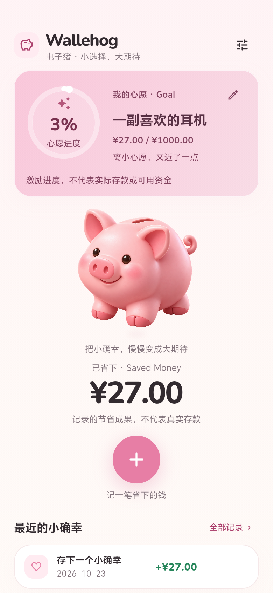

# Phase 2 视觉重构与验收

日期：2026-10-23。用户确认五步计划后实施；对应 PRODUCT_SPEC.md V01–V05、Q06/Q08/Q11。任务开始前工作区已有未提交的视觉代码与素材，本次在其上完善，未覆盖无关文件。

## 交付

- [手机视口与概念图并排对比](screenshots/phase2-comparison.html)：实际首页与原图两个手机区域保持比例比较，底部保留完整概念图。
- [实际首页](screenshots/phase2-home.png)、[无目标首页](screenshots/phase2-no-goal.png)、[计算器](screenshots/phase2-calculator.png)。
- [角色素材与完整生成提示](../assets/characters/README.md)。新角色使用内置 image_gen 生成，正式引用 pig-hero-v2.png；旧素材保留但不打包。

首页统一暖白、粉色渐变、深粉、字体层级、间距、圆角与阴影；Goal 左环右文，标准角色高 200dp，金额 44sp，加号 68dp，最大内容宽度 430dp。目标编辑触控区域 48dp。长目标名称不省略，大字体切换为上下布局；过长累计金额等比缩放。

没有新增运行依赖，没有修改 domain、data、application、数据库版本、表达式解析或计算器核心。概念图的登录、支出流水和导航未加入应用。参考图仅存在于评审文档，不在 pubspec 的资源清单中。

## 实际运行方式

设备 CGL-W00 / Android 16 / API 36 / arm64，通过 ADB 临时设置物理输出 780 × 1688、density 320、竖屏，相当于 **390 × 844 逻辑像素**。这是平板上的手机视口验证，不宣称已连接真实手机。

截图由真实应用 RepaintBoundary 按 2 倍像素导出，文件为 780 × 1688；含应用安全区域，不包含 Android 系统合成的状态栏图标。示例耳机目标 ¥1000、记录 ¥27 仅在独立 .uitest 应用的测试数据库中创建。首页圆环显示四舍五入的 3%，底层进度仍为 2.7%，未改变计算。

导出后已恢复原生 2032 × 3048、density 400、user_rotation=1、accelerometer_rotation=1。日常应用未卸载、未覆盖，未读取其数据库。

## 验证结果

| 检查 | 实际结果 |
| --- | --- |
| dart format | 27 个文件，最终检查 0 改动 |
| flutter analyze | 通过，无问题 |
| flutter test | 96 项通过，含已有业务与 SQLite 回归 |
| 新布局用例 | 390 × 844 首屏核心控件可见可点击；360 × 800、60 字目标、最大单笔金额、双倍字体无溢出 |
| Android debug | 构建成功 |
| 独立设备集成测试 | 最终版本 1 项通过，0 失败、0 跳过；快速记录、目标更新、编辑删除、重开一致性 |
| Android release | 0.3.0+3 arm64，18.7 MB，构建成功；仍为开发签名 |
| 截图目视检查 | 已检查首页、无目标首页和计算器；首屏核心层级清晰，文字无裁切 |

测试中发现大字体下圆环中心 100% 换行溢出，已通过中心内容限界缩放修复；未缩小完整目标信息。初次标准仓库构建未能解析 Android Gradle Plugin，使用项目现有 -UseMirrors 配置后成功。设备仍无法收集 logcat，Android XML 明确测试通过；SDK/Gradle 弃用警告仍在，不影响此次构建与测试结果。日志在 .buildlog/phase2-*.log，XML 在 build/app/outputs/androidTest-results/connected/debug/。

## 与概念图仍存在的差距

1. 当前角色已具备体积与统一光照，但仍是单张生成位图；缺少定制 3D 模型带来的可控视角、姿态与一致多状态。放大查看耳缘仍有少量亮边，手机显示尺寸下不明显。
2. 概念图具有更强的玩具光泽与饱和粉色；当前偏柔和黏土质感，页面保留暖白以支持文字和金额阅读。
3. 完整中文目标名、金额、编辑入口及产品说明占用更多空间。Goal 采用左环右文，尚不具备概念图中央目标物的海报感；未因此增加图片上传功能。
4. 英文与数字用 Nunito，中文沿用 Android 系统字体，中英文字形尚未完全统一。
5. 平板手机视口无法验证握持手感、真实手机系统栏、不同厂商字体和导航模式；TalkBack 人工体验仍待补充。

## 安装包

路径：build/app/outputs/flutter-apk/app-release.apk。SHA-256：`861E5072E40A16088731EDF3BA71F31630CD813C573113AF79BB27B4EE83B71A`。此次仅生成安装包，未覆盖日常应用。

## 日常应用安装补充

用户指出原应用未更新、测试应用表现为演示后，已在 2026-10-23 使用 adb install -r 成功覆盖安装日常包 dev.wallehog.wallehog 0.3.0+3，并启动。未卸载日常包或清除数据；已卸载 .uitest 与 .uitest.test 两个测试包，设备仅保留日常 Wallehog。未读取或核验用户私有记录内容。
