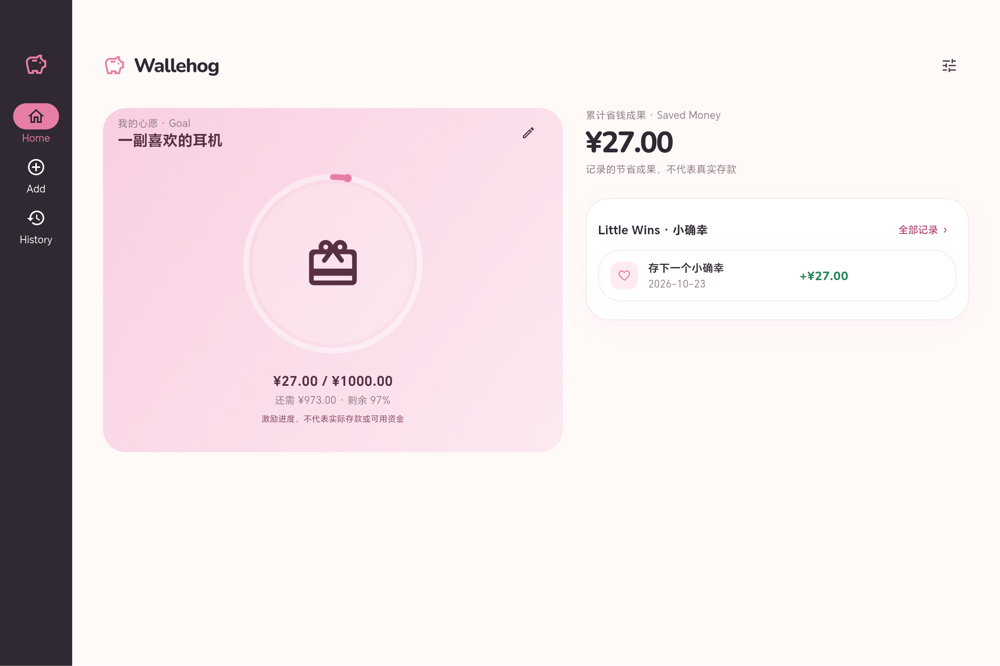
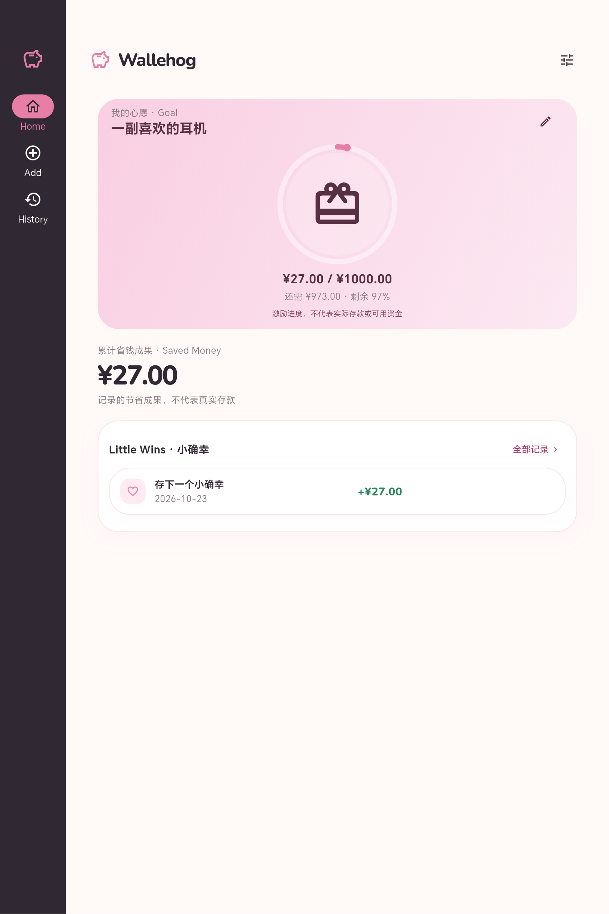

# 平板自适应验收

日期：2026-10-23。版本：0.4.0+4。依据用户平板适配授权与 PRODUCT_SPEC.md T01–T04；保留锁定手机界面及全部业务逻辑。

## 实现

- 可用窗口宽度 <600dp：原手机底栏；≥600dp：SDK NavigationRail 左侧固定导航。Home/Add/History 入口一致，Add 直接打开计算器，平板 History 在主区域显示并保留侧栏。
- 宽屏内容最大 1120dp、水平 32dp；内宽≥760dp 且文字缩放≤1.5 时，左 Goal / 右 Saved Money + Little Wins。宽屏圆环 224dp、Goal 最小 420dp。较窄平板/大字体回到最大 640dp 单列。
- 平板计算器最大宽 480dp，目标编辑继续使用原对话框；不让数字键盘横向铺满整个平板。
- 窗口缩放保留目标、历史选中状态和未提交的计算器输入。历史页系统返回回到首页。
- 不新增功能或依赖，不修改 domain/data/application、数据库版本、金额、进度或快速录入规则。

导航断点参考 [Flutter 官方自适应建议](https://docs.flutter.dev/ui/adaptive-responsive/general)，按窗口尺寸适配，避免将设备型号当作布局条件。

## 验证结果

| 检查 | 实际结果 |
| --- | --- |
| dart format | lib/test/integration_test，30 文件，最终检查 0 改动 |
| flutter analyze | 通过，无问题 |
| flutter test | 103 项全部通过，含 SQLite/迁移/领域/控制器和 widget |
| 手机回归 | 390×844、360×800 原布局与入口、安全区域、首屏内容通过 |
| 平板布局 | 600×960、813×1219、1219×813、1024×600；侧栏、单双列、快速保存 +¥27、历史/首页切换通过 |
| 断点与大字体 | 599↔600dp、双倍字体、60 字目标、缩放时保留未提交 27、历史页缩窄保留内容通过 |
| Android debug | 集成测试 debug 构建通过 |
| 平板横屏集成 | Gradle 原生测试运行器 1 项通过，0 失败/跳过 |
| 平板竖屏集成 | am instrument 明确 OK (1 test) |
| Android release arm64 | 构建成功，18.8 MB |
| 日常应用覆盖更新 | adb install -r 成功，0.4.0 / versionCode=4；启动 Status: ok，未卸载/清空数据 |

设备集成验证真实 SQLite：Add → 27 → 保存、Goal 更新、算式、编辑、删除、关闭重开一致性、清除及新建 Goal 归零；示例目标和记录仅存在独立 .uitest 数据库。

## 真实 Android Flutter 截图

连接 CGL-W00 / Android 16 / API 36 / arm64，原生物理分辨率 2032×3048、density=400；横屏约 1219×813dp，竖屏约 813×1219dp。RepaintBoundary 按 2 倍像素导出，原图分别 2439×1626 与 1626×2439，安全区域保留，不包含 Android 合成的系统栏图标。

| 状态 | 横屏 | 竖屏 |
| --- | --- | --- |
| 首页 | [实际截图](screenshots/tablet-landscape-home.png) | [实际截图](screenshots/tablet-portrait-home.png) |
| 历史 | [实际截图](screenshots/tablet-landscape-history.png) | [实际截图](screenshots/tablet-portrait-history.png) |
| 计算器 | [实际截图](screenshots/tablet-landscape-calculator.png) | [实际截图](screenshots/tablet-portrait-calculator.png) |
| 无目标 | [实际截图](screenshots/tablet-landscape-empty.png) | [实际截图](screenshots/tablet-portrait-empty.png) |

已目视检查横竖屏首页、历史与计算器：侧栏固定、Goal 主视觉和圆环居中、真实金额与最近记录可见、未见裁切/溢出。无目标截图保留用于复核。

## 环境与限制

已恢复 user_rotation=1、accelerometer_rotation=1；没有改动原生分辨率或密度。独立测试应用与测试包已卸载，日常数据库未读取或清空。Gradle 设备运行器仍无法收集部分 logcat，但明确测试通过；竖屏直接 instrumentation 结果为 OK。机器日志位于 .buildlog/tablet-*.log。

仅连接这一台平板；分屏、边界和大字体由 widget 验证，不宣称覆盖更多厂商真机。发布仍用开发签名。未推送无远程的父仓库。

最终 APK：build/app/outputs/flutter-apk/app-release.apk；SHA-256：`A1AB07FCA3FB5B44E29865EFC8A2E64D40F34FCBE2DDC8191C713CC1B8201EFB`。
