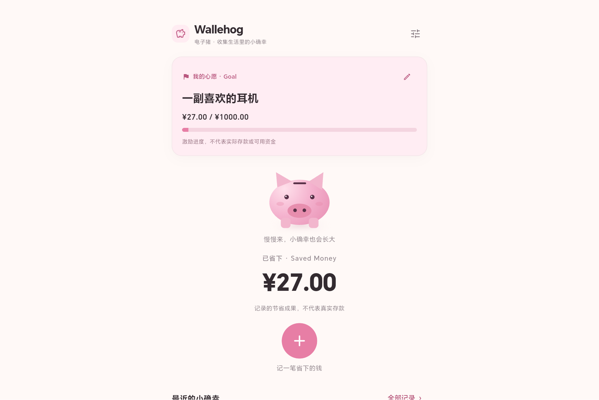
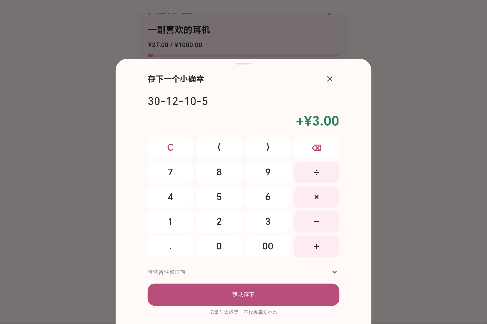

# 快速记录 UI v1.0 验证报告

2026-10-25：Phase 1 可靠性修复范围、故障回归及最终验证见 [可靠性修复报告](PHASE1_RELIABILITY_VERIFICATION.md)。本轮仅关闭可靠性阻塞项，不代表 Phase 1 已完成。

2026-10-23 小猪屋 v1 真机补充：CGL-W00 手机逻辑视口及平板横屏各 `OK (3 tests)`，本地 135 项回归、静态分析及普通 Android Debug 构建通过；截图与限制见[小猪屋验收](PIG_ROOM_VERIFICATION.md)。

最新增量：0.5.0+5 的本地备份、恢复预览及目标达成反馈见 [M2 验收](M2_VERIFICATION.md)。下方为各阶段历史记录。

日期：2026-10-23。依据用户的产品方向纠偏，在原 MVP 上重构；没有重建整个项目。保留解析器、SQLite、历史数据与适用测试。

## 本轮结果

- 普通流程：圆形加号直接打开计算器，输入正数/算式即可确认，无必填分类、预算、实际消费或备注。
- 首页：品牌与设置、Goal、静态猪、累计金额、圆形加号和次级最近记录；Good Choices 不再为首页主指标。
- 单目标：创建从零开始，编辑保留起点，清除不删记录；按 AUTOINCREMENT 历史高水位确定边界。
- 数据：显式 v1→v2 升级保留原记录/ID/比较字段/时间及删除后的最大 ID；旧记录编辑不被当成新记录计入 Goal。
- 失败：输入保留、同次请求幂等；写入成功但读取失败时仅重试读取。

## 实际检查

| 检查 | 结果 |
| --- | --- |
| dart format | 最终检查 25 个文件、0 改动，通过 |
| flutter analyze | 通过，无问题 |
| flutter test | 94 项通过（领域、汇总、迁移、真实 SQLite、控制器、widget） |
| Android debug | 构建成功 |
| 独立真机集成测试 | CGL-W00 / Android 16 / API 36 / arm64，1 项通过，0 失败、0 错误、0 跳过 |
| release APK | 0.2.0+2，arm64，17.2 MB；构建成功，无 INTERNET 权限 |
| 平板覆盖升级 | adb install -r 成功，从 0.1.0 升至 0.2.0；应用正常启动，原有记录金额仍可读取，未卸载/清除日常应用 |

新增验证覆盖：`27` 无分类保存、`2` 从加号到确认、四则算式、零/负数/无效输入拒绝、失败保留输入重试、提交后读取失败不重复、Goal 创建/修改/清除/新建归零、编辑旧记录不改变目标、删除重算、旧库迁移及高水位、重开一致性、窄屏双倍字体。

设备测试生成截图使用独立测试数据库中的演示目标和记录，不读取用户日常数据。原生 Android XML 报告位于 build/app/outputs/androidTest-results/connected/debug/；本轮日志在 .buildlog/refactor-*.log，均不提交机器产物。

APK：build/app/outputs/flutter-apk/app-release.apk。SHA-256：A2C85AC8F0978C2B7970DDE564C0A80DE12A0DC5491741919F55233B43238E75。导出截图后清理独立 UI 测试应用，保留日常应用。

## 设备截图

以下为平板上的 Flutter 实际渲染截图，不是设计稿；示例 ¥27 与心愿仅存在于测试沙盒。

[首页原图](screenshots/home.png) · [计算器原图](screenshots/calculator.png)

## 已处理问题与限制

- 新旧 adb 服务冲突：统一使用 SDK platform-tools 后识别平板。
- 该平板无法正常提供测试 logcat：使用 Flutter 官方支持的 Android 原生测试运行器；报告仍有无法收集 logcat 的警告，但 XML 明确测试通过。
- 测试结束默认卸载测试应用会清理截图：截图导出时显式保留 .uitest 应用，再从其私有目录读取。
- 调整了大字体标题换行与短屏猪展示高度；实际查看首页/计算器截图后再验收。
- SDK XML 与 Gradle/Flutter 模板仍有工具弃用警告，不等于业务测试失败；未改写外部 SDK。
- 只验证当前平板和自动化布局尺寸；仍需更多真机、TalkBack 人工体验、长期使用验证。
- 仍为开发签名和开发图标，未确定公开发布许可证；没有导出恢复，不承诺额外数据库加密。成长系统和复杂动画未实现。

下一步优先真实使用反馈与本地备份导出，不继续堆叠表单或分类功能。

## Phase 2 视觉验收补充（2026-10-23）

最新视觉、手机视口截图、素材来源、96 项回归及设备验证见 [Phase 2 验收报告](PHASE2_VISUAL_REVIEW.md)。上方 0.2.0 报告保留为上一轮历史结果。

## Locked UI v1.0（2026-10-23）

当前界面、两种尺寸真实 Android Flutter 截图和最终测试结果见[锁定合同验收报告](LOCKED_UI_VERIFICATION.md)。上方旧首页构图均为历史记录。

## 平板适配 0.4.0+4（2026-10-23）

当前平板导航、横竖屏截图、103 项测试及设备结果见[平板验收报告](TABLET_VERIFICATION.md)。手机锁定布局继续保留。

## 首页冻结与核心投币 v1.7（2026-10-24）

本轮改动、验证与实际 Android 录屏见[核心交互验收](CORE_FEEDBACK_VERIFICATION.md)。

## 轻量游戏化回应 v1.8（2026-10-24）

首次、过半与达成反馈、156 项回归与 Android 录屏见[本轮验收](WARM_FEEDBACK_VERIFICATION.md)。
