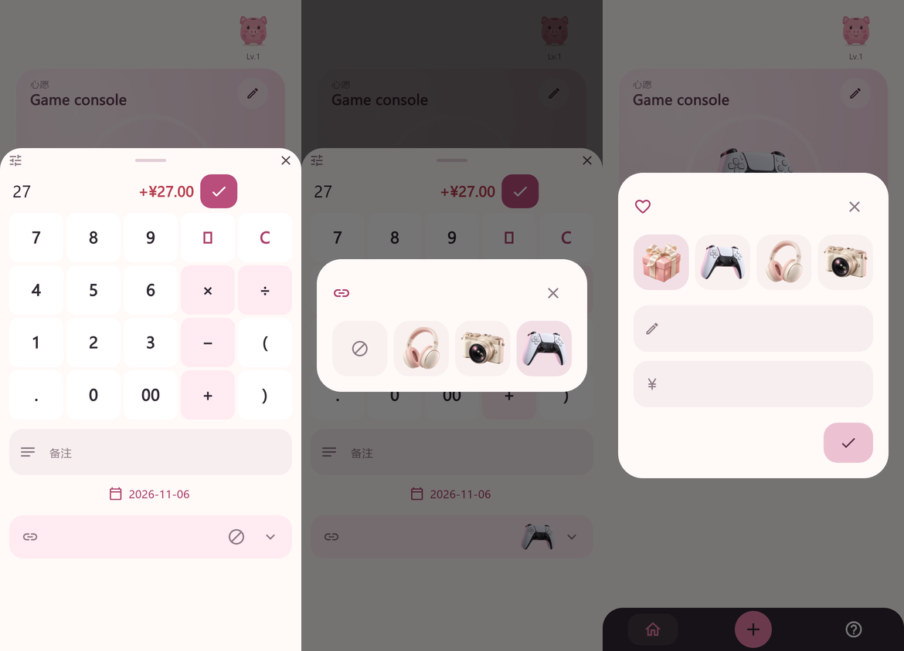

# Wish Binding Fix

[English](WISH_BINDING.md) · [简体中文](WISH_BINDING.zh-CN.md)

Updated: 2026-11-06. Implementation checkpoint; design review and device delivery remain pending.

## Confirmed behavior

The user's clarification on 2026-11-06 supersedes PRODUCT_SPEC W01–W02 only for these cases:

- If there are no wishes, creating the first wish adopts every unbound record in the same transaction. This also applies after all wishes have been cleared. Existing records and total savings are preserved.
- Creating another wish or switching among existing wishes does not adopt or transfer records.
- New records default to the current wish. The details area below note and date includes an icon-only binding control: a link icon plus the selected wish image, or a crossed-circle icon for unbound. Its compact rounded picker shows only already-created wishes and an unbound tile, using images without persistent text labels. Wish names remain available to screen readers and on long press. Editing initializes from the record's original binding. Selection is local until the record is saved; cancelling leaves storage unchanged.
- Saving an edit updates amount and binding atomically. A record belongs to at most one wish, and total savings count it once. Failed writes retain input; committed writes with failed snapshot reads use the existing recovery lock and reread without replay.

## Implementation

SQLite schema remains v4 and backup format remains v2. Explicit assignments in `goal_records` determine progress. Assigning an older record lowers the destination wish's `start_after_id` as needed so existing domain and v2 backup validation remain valid. It does not infer assignments for other records. AUTOINCREMENT identity, creation time, request token, and other wishes' assignments remain unchanged. Existing legacy migrations retain their historical boundaries.

The repository's `save` accepts `updateGoal` and nullable `goalId`. Without `updateGoal`, new records use the selected wish and edits preserve binding. With it, null explicitly unbinds. Repeated creation tokens cannot duplicate or silently change binding.

## Design review

On 2026-11-06 the user requested icon/image controls and removal of redundant name/target placeholders, then explicitly authorized completing code without waiting for Figma. The wish editor keeps the existing field icons and accessible names but removes the visible placeholders. No new icon font package is needed: Material Icons are already bundled.

This is a 390 × 844 Flutter-rendered preview with fictional data and locally loaded preview fonts, not device evidence. It shows the current implementation.

[Review area, frames 18–21](https://www.figma.com/design/CE0fcYnBBxRVcE1ORXw08P?node-id=12-12) retains complete 390 × 844 screens with editable text, vectors, and a shared binding-row component. It is a layout proposal using fictional data, not a running app. The existing review page and ordinary Design comments avoid paid annotations and Dev Mode.

The earlier text-based review was checked in the previous checkpoint. Starter MCP quota is still exhausted. The shared binding component was partially updated through the ordinary free browser editor, but the picker, unbound example, and wish editor in Figma have not been synchronized with this iteration. Per user instruction, further Figma work is deferred; use the current local preview above. User review completion and device acceptance remain pending. The connector has no comment retrieval tool.

## Verification and remaining delivery

Regression coverage includes empty-wishlist adoption, additional-wish/switch isolation, reassignment of older records, explicit unbinding, v2 backup round trips, invalid destinations, transaction rollback, token retries, cancelled selection, failed-save input retention, and two phone sizes plus tablet at double text scale. The same regressions now exercise image-only selection, while editor tests confirm that visible name/amount hints are absent. Historical migration fixtures explicitly recreate old boundaries rather than using today's creation behavior as a legacy fixture.

Final analysis/test results are recorded in [current status](STATUS.md). No physical-device validation or ordinary-app installation is claimed. Finish design feedback before building the converged Android artifact, validating it, and updating the ordinary installation with data preserved. There is no configured remote; push remains unavailable until the remote is confirmed.
