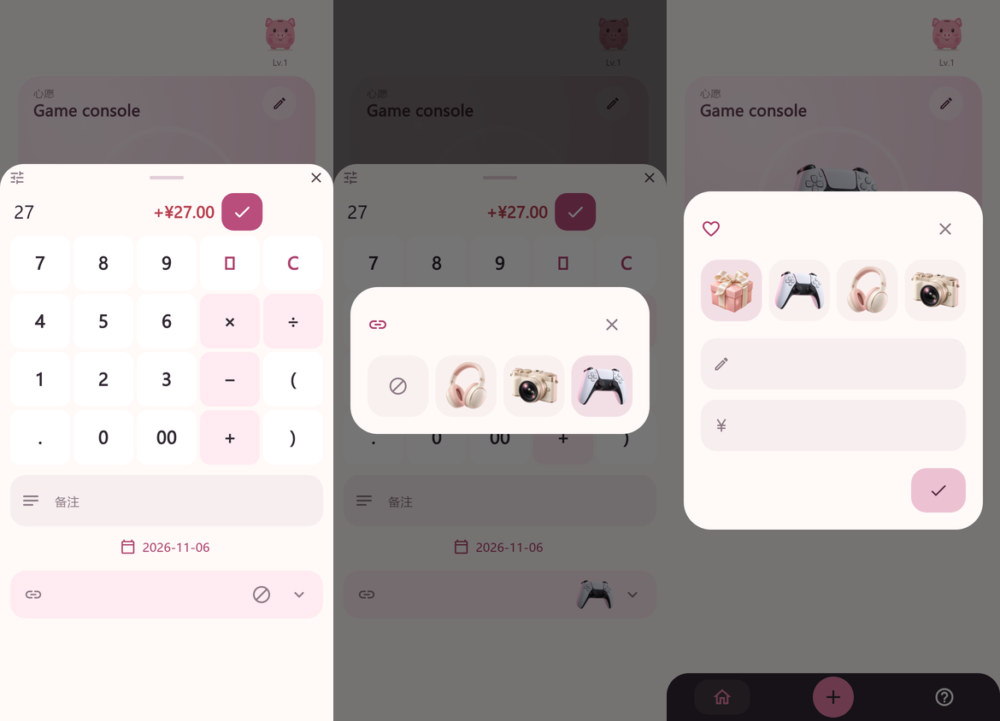

# 心愿绑定修复

[English](WISH_BINDING.md) · [简体中文](WISH_BINDING.zh-CN.md)

更新：2026-11-06。实现检查点；设计评审与设备交付仍待完成。

## 已确认行为

用户在 2026-11-06 的澄清仅在以下情形覆盖 PRODUCT_SPEC 的 W01–W02：

- 没有任何心愿时，创建第一个心愿会在同一事务接收所有未绑定记录。清除全部心愿后再次创建也适用。保留现有记录和累计金额。
- 已有心愿时新增或切换心愿，不自动接收或转移记录。
- 新记录默认绑定当前心愿。备注、日期下方的详情区提供纯图标绑定入口：链接图标加所选心愿图片，未绑定则显示圆圈斜杠图标。紧凑圆角选择弹窗仅展示已创建的心愿图片和一个未绑定图标，不常驻文字标签；读屏及长按提示仍可识别心愿名称。编辑时显示记录原有归属。选择只暂存在输入状态，保存记录时才写入；取消不改存储。
- 编辑保存将金额和绑定作为一个事务提交。每条记录最多属于一个心愿，累计节省只计一次。写入失败保留输入；提交后快照读取失败沿用全局恢复锁，只重读，不重放写入。

## 实现

SQLite 仍为 schema v4，备份仍为 v2。`goal_records` 的显式绑定决定进度。绑定更早的记录时，按需降低目标心愿的 `start_after_id`，保持现有领域与 v2 备份校验有效；不会因此推断其他记录的绑定。保留 AUTOINCREMENT 身份、创建时间、请求标识及其他心愿的归属。旧版迁移保留历史边界。

仓储 `save` 接受 `updateGoal` 和可空 `goalId`。未指定 `updateGoal` 时，新记录归当前心愿，编辑保留归属；指定后，null 明确表示解绑。重复新增请求标识不会重复记录或悄悄改变绑定。

## 设计评审

2026-11-06 用户要求改用图标／图片操作并去掉重复的名称、金额提示字，随后明确允许先完成代码、不等待 Figma。心愿编辑保留现有字段图标和无障碍名称，移除可见占位提示；使用应用已打包的 Material Icons，不新增图标字体包。

这是使用虚构数据、为预览加载本地字体的 390 × 844 Flutter 渲染图，不是真机证据，展示当前实现。

[评审区域，第 18–21 页](https://www.figma.com/design/CE0fcYnBBxRVcE1ORXw08P?node-id=12-12)保留完整 390 × 844 页面，包含可编辑文字、矢量和共用的绑定条目组件。这是使用虚构数据的布局提案，不是运行中的应用。沿用现有评审页和普通 Design 评论，不使用付费批注或 Dev Mode。

上一检查点已检查旧版文字方案。Starter MCP 免费额度仍已耗尽；通过普通免费浏览器编辑器部分更新了绑定主组件，但 Figma 的选择器、未绑定示例和心愿编辑尚未同步本轮修改。按用户要求暂缓后续 Figma 工作，当前实现以上方本地预览为准。设计评审完成确认与真机验收仍待进行。连接器没有评论读取工具。

## 验证与剩余交付

回归覆盖空心愿自动接收、新增其他心愿及切换不转移、更早记录改绑、明确解绑、v2 备份往返、无效目标、事务回滚、重复请求、取消选择、保存失败保留输入，以及两种手机尺寸和平板的双倍字号。相同回归现已覆盖纯图片选择；心愿编辑测试同时确认名称／金额可见提示字已移除。历史迁移测试显式构造旧边界，避免用当前创建行为替代旧版测试数据。

最终分析和测试结果见[当前状态](STATUS.zh-CN.md)。尚未进行真机验收或普通应用安装。先完成设计反馈，再构建收敛后的 Android 产物，验证并保留数据覆盖更新日常安装。当前没有配置远程；待确认远程后才能推送。
